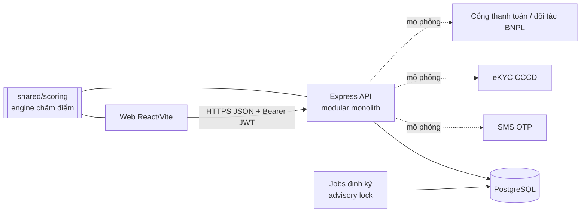
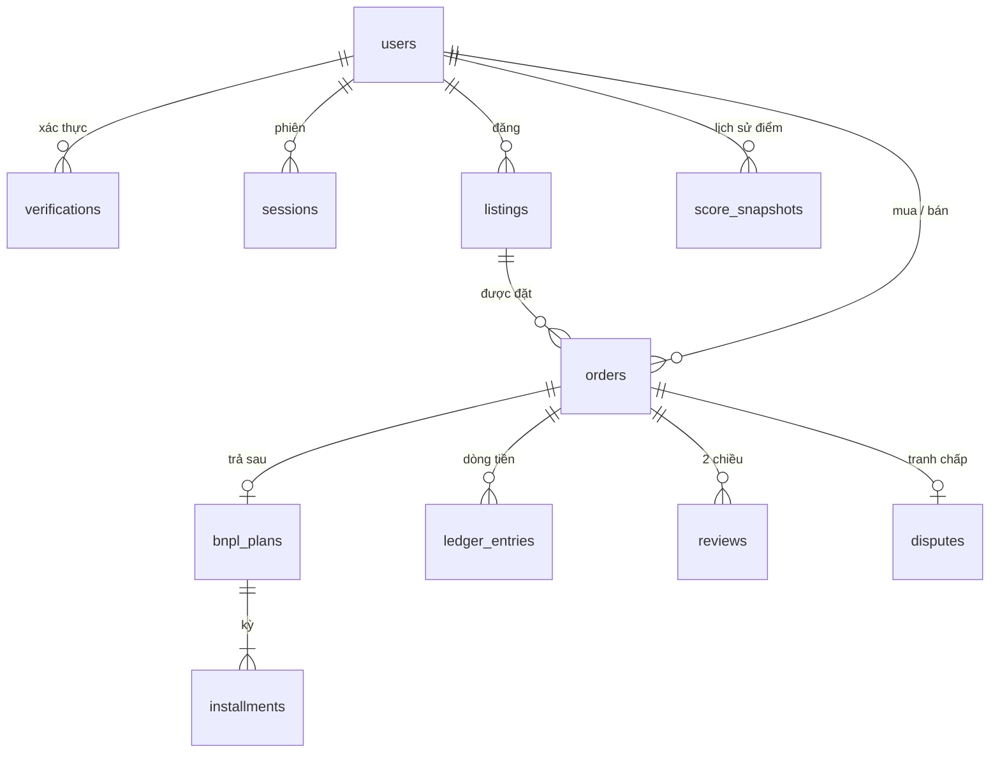
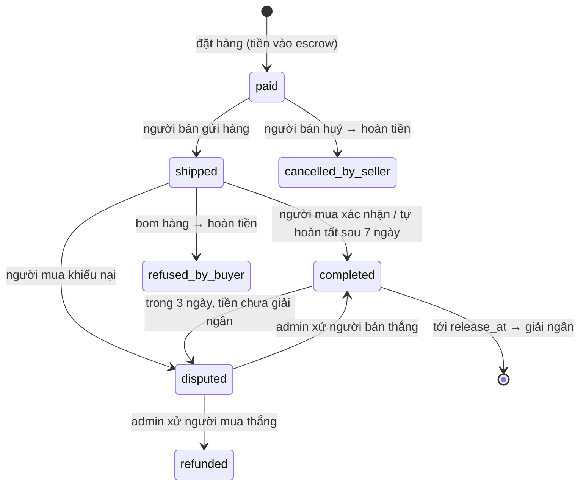
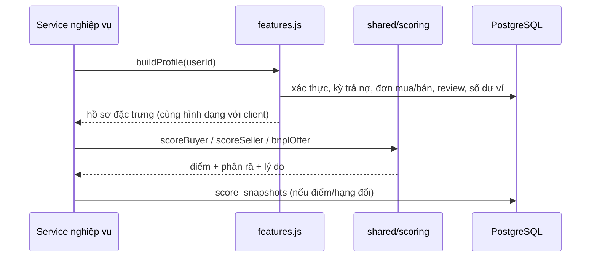

# ReOwn — Thiết kế backend (giai đoạn 1)

> Phạm vi: prototype chạy được cho vòng demo. Mọi thành phần bên thứ ba (SMS OTP, eKYC, cổng thanh toán, đối tác cho vay) đều **mô phỏng** nhưng đã có chỗ cắm rõ ràng.

## 1. Kiến trúc tổng quan



- **Modular monolith** (một tiến trình Express, chia module theo nghiệp vụ). Với đội 2 người code trong 4 tuần, tách microservice chỉ thêm rủi ro.
- **Engine chấm điểm dùng chung** (`shared/scoring`): cùng một mã nguồn chạy ở client (hiển thị, phòng thử điểm) và server (quyết định). **Server là nguồn sự thật**: client không bao giờ gửi điểm, giá hay đặc trưng lên.
- **PostgreSQL + SQL thuần (`pg`)**: dùng transaction, `SELECT … FOR UPDATE`, partial unique index và trigger — những thứ quyết định tính đúng của tiền, nên viết SQL rõ ràng thay vì giấu sau ORM.

```
server/src
├── app.js / index.js      khởi tạo Express, middleware bảo mật, lịch chạy jobs
├── config.js              biến môi trường + quy tắc vận hành (phí 4%, SLA giao hàng…)
├── db/                    pool + transaction helper, migrations/*.sql, seed
├── lib/                   lỗi chuẩn, validate (zod), crypto (HMAC/OTP), audit log
├── middleware/auth.js     requireAuth / optionalAuth / requireAdmin
├── services/              NGHIỆP VỤ — không biết gì về HTTP
│   ├── features.js        CSDL → hồ sơ đặc trưng cho engine
│   ├── scoring.js         tính điểm, lưu snapshot, điều kiện trả sau
│   ├── ledger.js          sổ cái bút toán kép
│   ├── orders.js          vòng đời đơn + escrow + tranh chấp + đánh giá
│   ├── bnpl.js            trả kỳ
│   ├── listings.js        tin đăng, cảnh báo rủi ro, gợi ý
│   ├── verification.js    eKYC (mô phỏng), băm giấy tờ
│   ├── auth.js            OTP, JWT, refresh token xoay vòng
│   └── jobs.js            tự hoàn tất, giải ngân, cập nhật điểm quá hạn
└── routes/                HTTP mỏng: validate → gọi service trong tx → trả JSON
```

## 2. Mô hình dữ liệu



| Bảng | Vai trò | Ràng buộc đáng chú ý |
|---|---|---|
| `users` | tài khoản, thu nhập tự khai | SĐT duy nhất, CHECK định dạng |
| `verifications` | SĐT / CCCD / ngân hàng / thẻ SV | **chỉ lưu HMAC + 4 số cuối**; unique `(type, doc_hash)` ⇒ một CCCD chỉ gắn một tài khoản |
| `otp_codes`, `sessions` | đăng nhập | mã OTP và refresh token đều lưu dạng băm |
| `listings` | tin đăng | trạng thái `active → reserved → sold / hidden`; lưu cờ rủi ro lúc đăng |
| `notifications` | thông báo trong app | `dedupe_key` unique chống gửi trùng (vd mỗi mốc nhắc hạn một lần); `sms` + `sms_sent_at` cho SMS mô phỏng; `link` chỉ nhận đường dẫn nội bộ |
| `conversations` · `messages` | chat mua–bán | một hội thoại cho mỗi (tin, người mua); mốc đã đọc riêng cho hai bên; `messages.flags` = cảnh báo (SĐT, Zalo, link) cho người nhận |
| `search_log` | từ khoá đã tìm (ẩn danh) | không lưu người tìm; dùng cho "Tìm nhiều", xoá sau 30 ngày |
| `listing_images` | ảnh sản phẩm (tối đa 3/tin, ảnh 0 = bìa) | lưu WebP ≤ 1280px trong `bytea` (≤ 600 KB); ảnh tải lên trước với `listing_id NULL`, gắn khi đăng tin; unique `(listing_id, position)`; ảnh bỏ quên > 1 ngày bị job xoá |
| `orders` | đơn hàng | **partial unique index**: mỗi tin chỉ có 1 đơn còn hiệu lực; unique `(buyer, idempotency_key)` |
| `ledger_entries` | sổ cái | **trigger hoãn kiểm tra tổng mỗi giao dịch = 0 khi COMMIT**; **chỉ ghi thêm** (chặn UPDATE/DELETE) |
| `bnpl_plans`, `installments` | khoản trả sau | `total = principal + fee`; `days_late` do server tính |
| `reviews` | đánh giá 2 chiều | unique `(order, direction)` — mỗi bên một lần, chỉ sau khi hoàn tất; khi chấm điểm, mỗi cặp người viết–người được chấm chỉ tính lượt mới nhất |
| `disputes` | tranh chấp | 1 đơn tối đa 1 tranh chấp |
| `score_snapshots` | lịch sử điểm | lưu phân rã + lý do + `engine_version` + sự kiện kích hoạt |
| `audit_logs` | nhật ký | mọi thao tác quan trọng: ai, làm gì, lúc nào, IP |

Tiền: VND, số nguyên. Không dùng float.

## 3. Dòng tiền — sổ cái bút toán kép

Mỗi nghiệp vụ tiền là một giao dịch gồm các bút toán có tổng bằng 0. Số dư ví = tổng bút toán `wallet` của người đó — không có cột "số dư" nào có thể bị sửa lệch.

| Nghiệp vụ | Bút toán |
|---|---|
| Nạp tiền (mô phỏng cổng thanh toán) | `external −x` · `wallet(A) +x` |
| Trả thẳng | `wallet(mua) −giá` · `escrow +giá` |
| Trả sau | `lender −giá` · `escrow +giá` (đối tác giải ngân vào ví giữ hộ) |
| Giải ngân cho người bán | `escrow −giá` · `wallet(bán) +96%` · `platform_fee +4%` |
| Hoàn tiền (trả thẳng) | `escrow −giá` · `wallet(mua) +giá` |
| Hoàn tiền (trả sau) | `escrow −giá` · `lender +giá`; các kỳ đã trả: `lender −đã trả` · `wallet(mua) +đã trả` |
| Trả một kỳ | `wallet(mua) −kỳ` · `lender +kỳ` |

ReOwn **không tự cho vay**: tài khoản `lender` đại diện cho đối tác tài chính có giấy phép, đúng với mô hình trong đề án.

## 4. Vòng đời đơn hàng



- `release_at = lúc hoàn tất + số ngày giữ tiền theo hạng người bán` (A: 0, B: 1, C: 3, D: 5, E: 7).
- Mỗi chuyển trạng thái: khoá dòng đơn (`FOR UPDATE`), kiểm tra **đúng vai** (chỉ người bán được gửi hàng, chỉ người mua được xác nhận), kiểm tra **đúng trạng thái nguồn**, ghi audit, tính lại điểm các bên liên quan.

### Đặt hàng — các lớp bảo vệ

1. `Idempotency-Key` bắt buộc: gửi lại cùng khoá trả về đúng đơn cũ, không trừ tiền 2 lần.
2. `SELECT listing FOR UPDATE` + kiểm tra còn `active`.
3. Khoá dòng người mua ⇒ các thao tác trừ ví của cùng một người chạy tuần tự.
4. **Giá lấy từ CSDL**; body chỉ chấp nhận `listingId, method, term` (zod `.strict()`).
5. Điều kiện trả sau tính lại ở server bằng engine dùng chung.
6. Partial unique index là chốt chặn cuối: dù 2 request lọt qua cùng lúc, CSDL chỉ nhận 1 đơn (đã có test song song).

## 5. Chấm điểm phía server



- **Đặc trưng suy ra từ dữ liệu giao dịch thật**, không có cột "điểm" nào để sửa tay.
  - Kỳ trả nợ: `days_late = 0` đúng hạn · 1–10 trễ nhẹ · 11–30 trễ nặng · >30 nợ xấu. Kỳ chưa trả mà quá hạn >30 ngày ⇒ **nợ xấu đang mở** (khoá điểm ≤ 30, tắt trả sau).
  - Người bán: giao đúng hẹn = gửi hàng trong 3 ngày; tranh chấp thua = tranh chấp xử người mua thắng.
- **Trọng số review** = điểm người mua mới nhất của người viết (từ snapshot). Review từ tài khoản clone điểm thấp gần như không có tác dụng. Mua đi mua lại để bơm sao không có tác dụng: mỗi người mua chỉ tính một lượt.
- **Trả trước** (migration `003`): `bnpl_plans.down_payment`; `principal` = phần đối tác tài trợ. Bút toán đặt hàng: ví −trả trước, đối tác −gốc tài trợ, giữ hộ +giá. Hoàn tiền đảo ngược đúng hai nguồn.
- **Giá tham chiếu**: `listings.market_price` là giá hệ thống tính lúc đăng (danh mục mẫu / trung vị tin cùng loại); trường `marketPrice` client gửi lên bị bỏ qua. Tin yêu cầu chuyển khoản / đặt cọc ngoài sàn bị từ chối (422).
- **Tính lại theo sự kiện**: gửi hàng, hoàn tất, bom hàng, trả kỳ, xác thực, tranh chấp, đánh giá. Job định kỳ tính lại cho người đang quá hạn, để luật nợ xấu có hiệu lực kể cả khi họ không đăng nhập.
- `engine_version` trong mỗi snapshot: khi giai đoạn 2 thay bằng mô hình ML, vẫn truy được điểm cũ được tính bằng phiên bản nào.

## 6. API

Tiền tố `/api`. Lỗi luôn có dạng `{ "error": { "code", "message", "details?" } }`.

| Method & đường dẫn | Quyền | Mô tả |
|---|---|---|
| `POST /auth/otp/request` | công khai | gửi OTP (dev: trả `devCode`) |
| `POST /auth/otp/verify` | công khai | đăng nhập / đăng ký → `accessToken` + cookie refresh |
| `POST /auth/refresh` · `POST /auth/logout` | cookie | xoay vòng / thu hồi phiên |
| `GET /me` · `PATCH /me` | người dùng | hồ sơ, điểm mua/bán, hạn mức; sửa tên, thu nhập, nợ khác |
| `GET /me/score/history` | người dùng | lịch sử điểm |
| `POST /me/verifications/:type` | người dùng | `cccd` · `bank` · `student` |
| `GET /me/orders?role=buyer\|seller` · `GET /me/listings` · `GET /me/wallet` | người dùng | đơn, tin, ví |
| `GET /listings` · `GET /listings/:id` | công khai | kèm điểm người bán công khai, cờ rủi ro; nếu đăng nhập: điều kiện trả sau của bạn |
| `POST /uploads/images` | người dùng | thân request = file ảnh JPEG/PNG/WebP (≤ 6 MB, 30 ảnh/10 phút); trả `{ id, url }`. Tối đa 9 ảnh chờ/người |
| `GET /images/:id` | công khai | ảnh WebP của tin chưa bị gỡ; `ETag`, cache 1 ngày, `Cross-Origin-Resource-Policy: cross-origin` |
| `PATCH /listings/:id` | chủ tin | sửa tên, giá, mô tả, tình trạng, khu vực, danh mục, `imageIds` (danh sách ảnh cuối cùng). Chỉ khi tin **đang bán** (đã có người đặt thì khoá); quét rủi ro lại; audit giá cũ → mới; giảm giá thì báo người đã nhắn hỏi |
| `GET /search/popular` | công khai | từ khoá tìm nhiều 14 ngày (≥ 2 lượt) |
| `GET /me/inbox` | người dùng | số thông báo + tin nhắn chưa đọc (client hỏi mỗi 20 giây) |
| `GET /me/notifications` · `POST /me/notifications/read` | người dùng | 30 thông báo mới nhất; đánh dấu đã đọc theo `ids` hoặc tất cả |
| `POST /conversations` · `GET /conversations` | người dùng | mở (hoặc lấy lại) hội thoại với người bán về một tin; danh sách kèm tin cuối + chưa đọc |
| `GET /conversations/:id/messages?after=` · `POST …/messages` | 2 bên | đọc (polling theo id) và gửi; người ngoài nhận **404**; 30 tin/phút. Tin yêu cầu chuyển khoản / đặt cọc ngoài ReOwn bị **chặn (422)**, SĐT / Zalo / link được gửi kèm cảnh báo |
| `POST /listings` · `DELETE /listings/:id` | người dùng | đăng (kèm `imageIds` tối đa 3, theo thứ tự hiển thị) / gỡ tin |
| `POST /recommendations` | công khai | gợi ý theo túi tiền (server) |
| `POST /orders` (header `Idempotency-Key`) | người dùng | đặt hàng `full` hoặc `bnpl` 3/6 kỳ |
| `POST /orders/:id/ship\|cancel` | người bán | gửi hàng / huỷ |
| `POST /orders/:id/confirm\|refuse\|dispute` | người mua | nhận hàng / bom hàng / khiếu nại |
| `POST /orders/:id/review` | 2 bên | đánh giá 1–5★ |
| `POST /installments/:id/pay` | người vay | trả kỳ (theo thứ tự) |
| `GET /admin/overview` | admin | phân bố hạng, dư nợ, **PAR30**, doanh thu phí, tin bị cờ, tranh chấp mở |
| `GET /admin/disputes` · `POST /admin/disputes/:id/resolve` | admin | xử lý tranh chấp |
| `POST /admin/mfa` | admin | bước 2 lớp (TOTP) → access token có `mfa`; sai mã trả 422, tối đa 5 lần / 15 phút |
| `GET /admin/listings/flagged` · `POST /admin/listings/:id/hide` · `POST /admin/listings/:id/keep` | admin | hàng chờ kiểm duyệt (tin cảnh báo chưa được xem); gỡ tin kèm lý do (người bán nhận thông báo) hoặc giữ tin (rời hàng chờ; sửa tin thì vào lại) |
| `GET /admin/users?q=` · `GET /admin/users/:id` · `POST /admin/users/:id/status` | admin | tìm người dùng (SĐT đã che); hồ sơ rủi ro (điểm tính trực tiếp, xác thực, ví, trả sau, đơn gần đây); khoá (bắt buộc lý do, thu hồi mọi phiên ngay) / mở khoá — không khoá được mình hay admin khác |
| `GET /admin/audit` · `GET /admin/users/:id/score-history` · `POST /admin/jobs/run` | admin | truy vết |
| `/dev/*` | **chỉ dev** | nạp ví giả, trả kỳ trễ N ngày, đẩy kỳ về quá hạn, chạy jobs với đồng hồ giả |

## 7. Bảo mật

| Rủi ro | Biện pháp |
|---|---|
| Sửa điểm / giá / hạn mức từ client | Server tự suy đặc trưng & tính điểm; giá lấy từ CSDL; zod `.strict()` loại trường lạ |
| Truy cập đơn của người khác (IDOR) | Mọi thao tác kiểm tra vai; đọc đơn không thuộc về mình trả **404** (không xác nhận đơn tồn tại) |
| Bán trùng / trừ tiền 2 lần | Khoá dòng + partial unique index + Idempotency-Key |
| Sai lệch tiền | Sổ cái bút toán kép, trigger cân bằng khi COMMIT, bảng chỉ ghi thêm |
| Dò OTP | 6 số ngẫu nhiên an toàn, hết hạn 5 phút, tối đa 5 lần nhập, 3 mã/10 phút/SĐT + rate-limit IP, so sánh hằng thời gian, lưu HMAC |
| Đánh cắp phiên | Access token JWT 15 phút (HS256 cố định thuật toán, kiểm `iss`/`aud`, gắn `sid` = họ phiên); refresh token ngẫu nhiên trong cookie `httpOnly; Secure`, `SameSite` cấu hình được, lưu SHA-256, **xoay vòng + phát hiện tái sử dụng ⇒ thu hồi cả họ phiên**. Đăng xuất / thu hồi làm access token của họ đó **hết hiệu lực ngay** |
| CSRF trên route dùng cookie | `/auth/refresh`, `/auth/logout` bắt buộc header `X-ReOwn-Client: web` (trang lạ không gửi được header tự đặt qua CORS danh sách trắng) |
| Quyền admin giả / mất SIM admin | Vai trò đọc lại từ CSDL mỗi request; admin phải qua **2FA TOTP** (`POST /api/admin/mfa`, 5 lần/15 phút) mới dùng được `/api/admin/*`; production thiếu `ADMIN_TOTP_SECRET` thì khoá khu admin |
| Spam / DoS | Rate limit chung 300 req/phút/IP + riêng: đặt hàng, đăng tin, đánh giá, gợi ý (30/phút), xác thực giấy tờ (5/giờ); `TRUST_PROXY` cấu hình theo hạ tầng để không bị giả `X-Forwarded-For` |
| Dò CCCD / tài khoản ngân hàng đã đăng ký | Thông báo trùng chung chung + giới hạn 5 lần/giờ + ghi audit |
| Race (check-then-act) | OTP 3 mã/10 phút khoá theo SĐT (`pg_advisory_xact_lock`); trần 3 tin khi chưa xác thực khoá theo người bán |
| Ví âm | Ngoài khoá dòng ở ứng dụng, bảng `wallet_balances` (trigger từ sổ cái) có `CHECK (balance >= 0)` — chốt chặn cuối ở CSDL; không sửa trực tiếp được |
| File độc giả dạng ảnh, lộ vị trí qua ảnh | Kiểm tra chữ ký nhị phân (không tin Content-Type); **giải mã + mã hoá lại bằng sharp** sang WebP ⇒ bỏ EXIF/GPS, loại file đa hình; giới hạn 40 triệu điểm ảnh (chống bom giải nén); ảnh trả kèm `CSP: sandbox` + `nosniff`; chỉ gắn được ảnh của chính mình, chưa dùng |
| Lỡ tay xoá dữ liệu thật | `seed` / `migrate --reset` bị chặn ở production và khi chưa bật `DEV_TOOLS`; seed không xoá CSDL đã có đơn nếu thiếu `--force` |
| Lộ dữ liệu cá nhân | Không lưu số CCCD/số tài khoản gốc; API công khai chỉ trả tên, trường, điểm người bán; log che SĐT |
| Nhiều tài khoản ảo (sybil) | Mỗi CCCD / tài khoản ngân hàng chỉ gắn 1 người dùng; review có trọng số theo uy tín người viết |
| SQL injection | Luôn dùng tham số `$1…`; LIKE được escape |
| Lộ thông tin lỗi | Handler trả thông điệp chung cho lỗi 500, không lộ stack |
| Header / CORS | `helmet`, CORS danh sách trắng, body tối đa 100 KB |
| Công cụ demo lọt lên production | `/api/dev` chỉ mount khi đặt rõ `DEV_TOOLS=true` (quên `NODE_ENV` cũng **không** tự bật); `DEV_TOOLS` + production ⇒ không khởi động; thiếu khoá hoặc khoá < 32 ký tự ⇒ không khởi động |

## 8. Tác vụ định kỳ

Chạy mỗi 5 phút (`JOBS_INTERVAL_SEC`), có `pg_try_advisory_lock` để khi chạy nhiều instance chỉ một tiến trình xử lý:

1. Đơn `shipped` quá 7 ngày không phản hồi ⇒ tự hoàn tất.
2. Đơn tới `release_at` và không tranh chấp ⇒ giải ngân.
3. Người có kỳ quá hạn ⇒ tính lại điểm.
4. Người bán có tin đang bán mà snapshot điểm cũ hơn 1 ngày ⇒ tính lại (snapshot là cache cho trang danh sách).
5. Nhắc hạn trả kỳ: còn ≤ 3 ngày, đến hạn hôm nay, quá hạn — mỗi mốc một lần (`dedupe_key`); hai mốc sau kèm SMS mô phỏng (log đã che số).
6. Dọn OTP hết hạn > 1 ngày, phiên đã hết hạn, ảnh bỏ quên, `search_log` > 30 ngày; `audit_logs` được giữ lại có chủ đích.

**Tìm kiếm:** `listings.search_text` = tiêu đề + mô tả đã bỏ dấu (ứng dụng ghi, `migrate` điền cho dòng cũ). SQL lọc sơ bộ theo từng từ (`LIKE`, và `word_similarity` của pg_trgm cho từ ≥ 5 ký tự để chịu gõ sai), rồi `shared/search.js` xếp hạng — cùng thuật toán với giao diện.

**Thông báo theo sự kiện** (ghi trong cùng transaction): đơn mới (người bán, SMS), đã gửi hàng, người mua đã nhận, tiền về ví, huỷ / từ chối nhận, khiếu nại mở / xử lý, có đánh giá mới, giảm giá món đã hỏi.

Chạy tay: `POST /api/admin/jobs/run` (admin + 2FA).

## 9. Chạy thử

```bash
# PostgreSQL 14+ đang chạy, tạo DB: createdb reown
cd server
cp .env.example .env
npm install
npm run db:reset     # tạo bảng + dữ liệu mẫu (lịch sử được sinh bằng chính các service)
npm run dev          # http://localhost:4000/api/health
npm test             # 64 test tích hợp trên PostgreSQL thật (DB reown_test)
```

Tài khoản mẫu (mã OTP trả về trong response ở chế độ dev):

| SĐT | Người dùng | Ghi chú |
|---|---|---|
| 0900000001 | Nguyễn Minh | mới, chưa CCCD |
| 0900000002 | Trần Ngọc Lan | hạng A, lịch sử tốt |
| 0900000003 | Lê Quốc Huy | từng trễ, bom hàng, thua tranh chấp |
| 0900000011–13 | Bảo · Hà · Tâm | người bán |
| 0900000014 | shop_passdo_gia_re | người bán hạng E |
| 0999999999 | Quản trị | admin — dev không cấu hình `ADMIN_TOTP_SECRET` thì bước 2FA nhận mã bất kỳ 6 số |

## 10. Việc cho giai đoạn sau

- Thay các nhà cung cấp mô phỏng: SMS OTP, eKYC (đọc chip CCCD), cổng thanh toán (webhook có ký), API đối tác cho vay.
- Ảnh sản phẩm: upload lên object storage qua URL ký sẵn, quét nội dung.
- Điểm người bán trên trang danh sách đọc từ snapshot (1 truy vấn cho cả trang); cache danh sách cho trang gợi ý 15 giây, xoá khi có thao tác ghi. Chạy nhiều instance thì chuyển rate-limit và cache sang Redis.
- Tìm kiếm chưa bỏ dấu phía server (cần extension `unaccent` + cột sinh sẵn).
- Thông báo (nhắc hạn trả kỳ trước 3 ngày), chat mua–bán.
- Giai đoạn 2: pipeline dữ liệu để huấn luyện mô hình rủi ro; chạy song song (shadow) với rule-based trước khi thay.
- Tuân thủ: chính sách quyền riêng tư, đồng ý chia sẻ dữ liệu với đối tác, thời hạn lưu trữ — cần cố vấn pháp lý.
